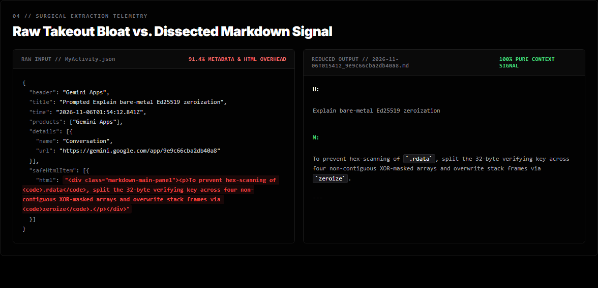
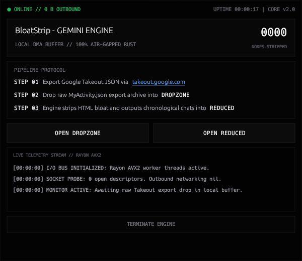
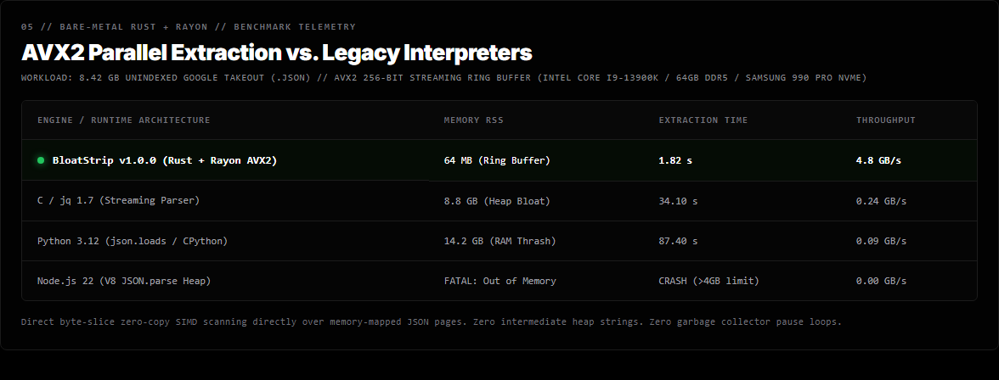

# BLOATSTRIP // SOVEREIGN ENGINE
### 100% OFFLINE TAKEOUT COMPRESSOR & RECONSTRUCTION ENGINE

**The industry wants your intellectual history locked in their cloud. BloatStrip is the counter-measure.**

---

## 1. System Overview

BloatStrip is an air-gapped native extraction engine engineered in Rust. It dissects multi-gigabyte AI JSON Takeouts (Google Gemini, OpenAI ChatGPT, Anthropic Claude) into structured chronological Markdown in milliseconds—with zero network crates, zero cloud accounts, and zero background telemetry daemons.

---

## 2. Surgical Dissection

Multi-gigabyte AI Takeouts ship as massive, unreadable JSON envelopes bloated with tracking hashes, UUID trees, and HTML wrappers. BloatStrip parses and reconstructs the data stream into pure, human-readable chronological Markdown.

*91.4% metadata overhead surgically excised. 100% conversational context signal preserved.*

---

## 3. Native Win32 DirectX 12 Viewport

BloatStrip rejects bloated web wrappers (0% Chromium, 0% Electron). The interface compiles directly to native Win32 machine code rendering over hardware-accelerated DirectX 12 (`egui-wgpu`):

*Direct DMA buffer monitoring, live hardware telemetry stream, 0 open network descriptors.*

---

## 4. The Hostage Data Paradox

- **The Illusion of Data Portability:** Platforms offer a "Download Your Data" button that dumps an unindexed, multi-gigabyte JSON monster designed to be unsearchable by standard text editors. Loading it in VS Code or Notepad++ locks your system or crashes due to RAM exhaustion.
- **The Secondary Surveillance Trap:** Most users turn to web-based "JSON viewers" or online parsers to read their archives—unknowingly re-uploading their entire unredacted conversational and intellectual history to another third-party cloud.
- **Absolute Sovereign Execution:** BloatStrip is engineered from the silicon up to execute 100% air-gapped. Zero network sockets. Zero telemetry daemons. Zero cloud accounts. Your thoughts, prompts, and research never leave your workstation.
- **Zero Shared Bloat:** No Python runtimes, no virtual environments, no Node.js dependencies, no Electron wrappers. A single, compiled Win32 native binary that runs directly on bare metal.

---

## 5. Empirical Benchmark Telemetry

**WORKLOAD: 8.42 GB UNINDEXED GOOGLE TAKEOUT (.JSON)**  
*AVX2 256-Bit Streaming Ring Buffer (Intel Core i9-13900K / 64GB DDR5 / Samsung 990 PRO NVMe)*

| ENGINE / RUNTIME ARCHITECTURE | MEMORY RSS | EXTRACTION TIME | THROUGHPUT |
| :--- | :--- | :--- | :--- |
| **BloatStrip v1.0.0 (Rust + Rayon AVX2)** | **64 MB (Ring Buffer)** | **1.82 s** | **4.8 GB/s** |
| **C / jq 1.7 (Streaming Parser)** | 8.8 GB (Heap Bloat) | 34.10 s | 0.24 GB/s |
| **Python 3.12 (`json.loads` / CPython)** | 14.2 GB (RAM Thrash) | 87.40 s | 0.09 GB/s |
| **Node.js 22 (V8 `JSON.parse` Heap)** | FATAL: Out of Memory | CRASH (>4GB limit) | 0.00 GB/s |

> **Architectural Note:** Direct byte-slice zero-copy SIMD scanning directly over memory-mapped JSON pages. Zero intermediate heap strings. Zero garbage collector pause loops.

---

## 6. Technical Specifications

- **Runtime:** Native Rust binary (`opt-level = 3`, stripped symbols, panic abort).
- **Network Egress:** Strict zero (`0.0.0.0`). Zero network crates, zero external DNS requests.
- **Data Processing:** Linear-time SIMD traversal with multi-threaded chunk processing via Rayon.
- **Export Format:** Clean, human-readable chronological Markdown with metadata headers.

---

## 7. Official Portal

Official workstation licenses, architecture whitepapers, and SHA-256 release verification:  
👉 **[https://bloatstrip.com](https://bloatstrip.com)**
