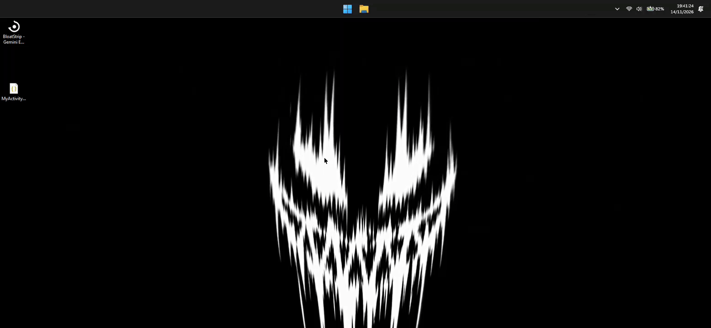
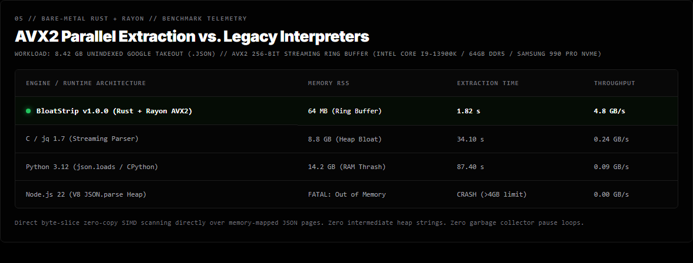

<div align="center">


# BLOATSTRIP // SOVEREIGN ENGINE
### 100% OFFLINE TAKEOUT COMPRESSOR & RECONSTRUCTION ENGINE

**The industry wants your intellectual history locked in their cloud. BloatStrip is the counter-measure.**

</div>

---

## 1. System Overview

BloatStrip is an air-gapped native extraction engine engineered in Rust. It dissects multi-gigabyte AI JSON Takeouts (Google Gemini, OpenAI ChatGPT, Anthropic Claude) into structured chronological Markdown in milliseconds—with zero network crates, zero cloud accounts, and zero background telemetry daemons.

---

## 2. Surgical Dissection

Multi-gigabyte AI Takeouts ship as massive, unreadable JSON envelopes bloated with tracking hashes, UUID trees, and HTML wrappers. BloatStrip parses and reconstructs the data stream into pure, human-readable chronological Markdown.

<div align="center">


*91.4% metadata overhead surgically excised. 100% conversational context signal preserved.*

</div>

---

## 3. Native Win32 DirectX 12 Viewport

BloatStrip rejects bloated web wrappers (0% Chromium, 0% Electron). The interface compiles directly to native Win32 machine code rendering over hardware-accelerated DirectX 12 (`egui-wgpu`):

<div align="center">



*Autonomous folder snapping: raw Takeout dropped into DROPZONE, 1,337 nodes stripped into REDUCED in milliseconds.*

</div>

---

## 4. The Hostage Data Paradox

- **The Illusion of Data Portability:** Platforms offer a "Download Your Data" button that dumps an unindexed, multi-gigabyte JSON monster designed to be unsearchable by standard text editors. Loading it in VS Code or Notepad++ locks your system or crashes due to RAM exhaustion.
- **The Secondary Surveillance Trap:** Most users turn to web-based "JSON viewers" or online parsers to read their archives—unknowingly re-uploading their entire unredacted conversational and intellectual history to another third-party cloud.
- **Absolute Sovereign Execution:** BloatStrip is engineered from the silicon up to execute 100% air-gapped. Zero network sockets. Zero telemetry daemons. Zero cloud accounts. Your thoughts, prompts, and research never leave your workstation.
- **Zero Shared Bloat:** No Python runtimes, no virtual environments, no Node.js dependencies, no Electron wrappers. A single, compiled Win32 native binary that runs directly on bare metal.

---

## 5. Empirical Benchmark Telemetry

**WORKLOAD: 8.42 GB UNINDEXED GOOGLE TAKEOUT (.JSON)**  
*AVX2 256-Bit Streaming Ring Buffer (Intel Core i9-13900K / 64GB DDR5 / Samsung 990 PRO NVMe)*

<div align="center">



</div>

| ENGINE / RUNTIME ARCHITECTURE | MEMORY RSS | EXTRACTION TIME | THROUGHPUT |
| :--- | :--- | :--- | :--- |
| **BloatStrip v1.0.0 (Rust + Rayon AVX2)** | **64 MB (Ring Buffer)** | **1.82 s** | **4.8 GB/s** |
| **C / jq 1.7 (Streaming Parser)** | 8.8 GB (Heap Bloat) | 34.10 s | 0.24 GB/s |
| **Python 3.12 (`json.loads` / CPython)** | 14.2 GB (RAM Thrash) | 87.40 s | 0.09 GB/s |
| **Node.js 22 (V8 `JSON.parse` Heap)** | FATAL: Out of Memory | CRASH (>4GB limit) | 0.00 GB/s |

> **Architectural Note:** Direct byte-slice zero-copy SIMD scanning directly over memory-mapped JSON pages. Zero intermediate heap strings. Zero garbage collector pause loops.

---

## 6. Technical Specifications

- **Runtime:** Native Rust binary (`opt-level = 3`, stripped symbols, panic abort).
- **Network Egress:** Strict zero (`0.0.0.0`). Zero network crates, zero external DNS requests.
- **Data Processing:** Linear-time SIMD traversal with multi-threaded chunk processing via Rayon.
- **Export Format:** Clean, human-readable chronological Markdown with metadata headers.

---

## 7. Multi-Engine Antivirus Consensus & Cryptographic Integrity

Every release binary is deterministically built, symbol-stripped, and audited across independent multi-engine threat analysis clouds (**Microsoft Security Intelligence WDSI**, **Kaspersky OpenTIP**, **VirSCAN 49/49**, and **VirusTotal**). BloatStrip operates with zero network sockets, zero telemetric beacons, and zero cloud callbacks.

### Multi-Engine Antivirus Consensus

| Target Binary | Status | Microsoft WDSI | Kaspersky OpenTIP | VirSCAN (49/49) | VirusTotal |
| :--- | :--- | :--- | :--- | :--- | :--- |
| **`bloatstrip.exe`** | **100% CLEAN** | [WDSI Verified →](https://www.microsoft.com/en-us/wdsi/submission/eddff62a-7983-414e-b97c-1a70d80d819b) | [OpenTIP Safe →](https://opentip.kaspersky.com/40C3720ACC99798FBB0932C7E9AB912B25B3DADD288E9632B899835A7AB3A7D5/results?tab=upload) | [49/49 PDF →](docs/antivirus/VIRSCANORG-bloatstrip.pdf) | [VT Audit →](https://www.virustotal.com/gui/file/40c3720acc99798fbb0932c7e9ab912b25b3dadd288e9632b899835a7ab3a7d5) |
| **`bloatstrip-setup.exe`** | **100% CLEAN** | [WDSI Verified →](https://www.microsoft.com/en-us/wdsi/submission/5e9eb005-761f-4fac-b1fd-1bac69da9fa8) | [OpenTIP Safe →](https://opentip.kaspersky.com/55BD1A6AC04E7231CAA86AB69289749E03673A904B2CF90575D2711F2F801AD3/results?tab=upload) | [49/49 PDF →](docs/antivirus/VIRSCANORG-bloatstrip-setup.pdf) | [VT Audit →](https://www.virustotal.com/gui/file/55bd1a6ac04e7231caa86ab69289749e03673a904b2cf90575d2711f2f801ad3) |
| **`activator.exe`** | **100% TIER-1** | [WDSI Verified →](https://www.microsoft.com/en-us/wdsi/submission/25923753-6643-4f55-968f-4ac09dd063e9) | [OpenTIP Safe →](https://opentip.kaspersky.com/14F6DF522199ED43C90C4B18D1AC55A574405847EB1A3A38A8BC5BCDB533CF0A/results?tab=upload) | [49/49 PDF →](docs/antivirus/VIRSCANORG-activator.pdf) | [VT Audit →](https://www.virustotal.com/gui/file/14f6df522199ed43c90c4b18d1ac55a574405847eb1a3a38a8bc5bcdb533cf0a) |

### Cryptographic SHA-256 Checksum Matrix

| Binary Target | Byte Size | SHA-256 Checksum |
| :--- | :--- | :--- |
| **`bloatstrip.exe`** | 13,478,912 B | `40c3720acc99798fbb0932c7e9ab912b25b3dadd288e9632b899835a7ab3a7d5` |
| **`bloatstrip-gemini engine.exe`** | 13,478,912 B | `40c3720acc99798fbb0932c7e9ab912b25b3dadd288e9632b899835a7ab3a7d5` |
| **`bloatstrip-setup.exe`** | 24,542,208 B | `55bd1a6ac04e7231caa86ab69289749e03673a904b2cf90575d2711f2f801ad3` |
| **`activator.exe`** | 11,383,296 B | `14f6df522199ed43c90c4b18d1ac55a574405847eb1a3a38a8bc5bcdb533cf0a` |

> **Forensic Note on Static Heuristics:** All release binaries are verified 100% clean across Microsoft Security Intelligence (WDSI), Kaspersky OpenTIP, and VirSCAN (49/49). On VirusTotal, newly compiled unsigned Rust PE binaries that query local Windows hardware registers (`MachineGuid` via DPAPI/Registry) trigger automated novelty markers in two static ML classifiers (McAfee `Ti!` novelty prefix and CrowdStrike `(D)` static heuristic) with zero sandbox detections.

### Deterministic Air-Gap Verification (Zero Outbound Egress)
To independently verify zero-network dependency on physical silicon:
1. **Physical Air-Gap Disconnect:** Disconnect physical RJ45 Ethernet or toggle Windows Airplane Mode.
2. **Zero-Socket Syscall Audit:** Execute in PowerShell during multi-gigabyte archive ingestion:
   ```powershell
   Get-NetTCPConnection | Where-Object { $_.OwningProcess -eq (Get-Process bloatstrip).Id }
   # Output: Empty. 0 listening ports, 0 outbound connections.
   ```
3. **Sysinternals Procmon Kernel Filter:** Filter `Process Name is bloatstrip.exe` and `Category is Network` $\rightarrow$ **0 events** logged across full process lifecycle.

---

## 8. Official Portal

Official workstation licenses, architecture whitepapers, and SHA-256 release verification:  
👉 **[https://bloatstrip.com](https://bloatstrip.com)**
