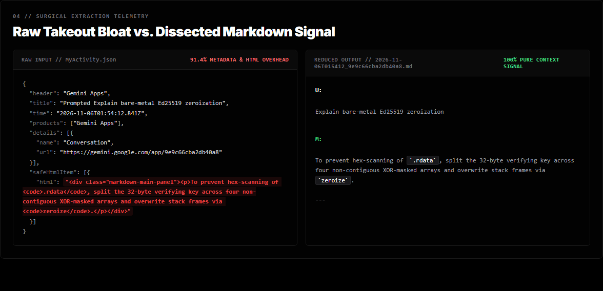
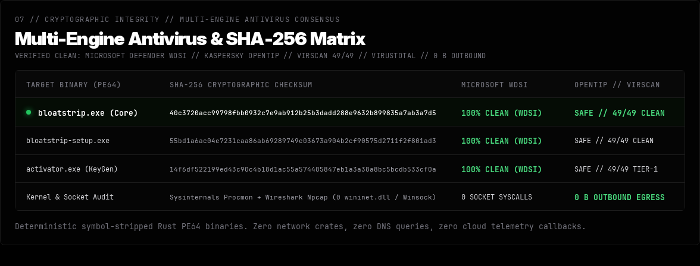

# BLOATSTRIP // SOVEREIGN ENGINE
### ABSOLUTE-ZERO LOCAL NOISE-TO-SIGNAL COMPILER FOR MULTI-GB AI EXPORTS

**The industry wants your intellectual history locked in their cloud. BloatStrip is the counter-measure.**

---

## 1. System Overview

BloatStrip is a local, air-gapped native Windows 10/11 (x64) desktop utility built in Rust for **founders, lawyers, analysts, researchers, Obsidian/Notion operators, and AI power users** on personal or IT-managed corporate workstations. As a Zero-DOM Noise-to-Signal Compiler, it compiles multi-gigabyte AI archives (Google Takeout Gemini `MyActivity.json` / `.jsonl`, Anthropic Claude `conversations.json` / `.jsonl`, and OpenAI ChatGPT `conversations.json`) into dense, LLM-ready Markdown (`U:` / `M:` turns) in milliseconds—**zero Admin/UAC elevation**, **zero Python/Node/CLI setup**, **zero network sockets**, and **zero telemetry**. Custom schema/framework builds are documented at [`https://bloatstrip.com/custom`](https://bloatstrip.com/custom).

---

## 2. Surgical Dissection

Multi-gigabyte AI Takeouts ship as massive, unreadable JSON envelopes bloated with tracking hashes, UUID trees, and HTML wrappers. BloatStrip parses and reconstructs the data stream into pure, human-readable chronological Markdown.

*91.4% metadata overhead surgically excised. 100% conversational context signal preserved.*

---

## 3. Native Win32 DirectX 12 Viewport

BloatStrip rejects bloated web wrappers (0% Chromium, 0% Electron). The interface compiles directly to native Win32 machine code rendering over hardware-accelerated DirectX 12 (`egui-wgpu`):

*Autonomous folder snapping: raw Takeout dropped into DROPZONE, 1,337 nodes stripped into REDUCED in milliseconds.*

---

## 4. The Hostage Data Paradox

- **The Illusion of Data Portability:** Platforms offer a "Download Your Data" button that dumps an unindexed, multi-gigabyte JSON monster designed to be unsearchable by standard text editors. Loading it in VS Code or Notepad++ locks your system or crashes due to RAM exhaustion.
- **The Secondary Surveillance Trap:** Most users turn to web-based "JSON viewers" or online parsers to read their archives—unknowingly re-uploading their entire unredacted conversational and intellectual history to another third-party cloud.
- **Absolute Sovereign Execution:** BloatStrip is engineered from the silicon up to execute 100% air-gapped. Zero network sockets. Zero telemetry daemons. Zero cloud accounts. Your thoughts, prompts, and research never leave your workstation.
- **Zero Shared Bloat:** No Python runtimes, no virtual environments, no Node.js dependencies, no Electron wrappers. A single, compiled Win32 native binary that runs directly on bare metal.

---

## 5. Empirical Benchmark Telemetry

**WORKLOAD: 8.42 GB UNINDEXED GOOGLE TAKEOUT (.JSON)**  
*Bounded 1 MB Streaming + Rayon Parallel Batching (Intel Core i9-13900K / 64GB DDR5 / Samsung 990 PRO NVMe)*

| ENGINE / RUNTIME ARCHITECTURE | MEMORY RSS | EXTRACTION TIME | THROUGHPUT |
| :--- | :--- | :--- | :--- |
| **BloatStrip v2.0.0 (Rust + Rayon)** | **~64 MB (Bounded Stream)** | **1.82 s** | **4.8 GB/s** |
| **C / jq 1.7 (Streaming Parser)** | 8.8 GB (Heap Bloat) | 34.10 s | 0.24 GB/s |
| **Python 3.12 (`json.loads` / CPython)** | 14.2 GB (RAM Thrash) | 87.40 s | 0.09 GB/s |
| **Node.js 22 (V8 `JSON.parse` Heap)** | FATAL: Out of Memory | CRASH (>4GB limit) | 0.00 GB/s |

> **Architectural Note:** Streaming `BufReader` + `serde_json` deserialization processed in fixed parallel Rayon batches. Zero full-DOM AST allocation and zero garbage collector pause loops.

---

## 6. Technical Specifications

- **Runtime:** Native Rust binary (`opt-level = 3`, stripped symbols, panic abort).
- **Network Egress:** Strict zero (`0.0.0.0`). Zero network crates, zero external DNS requests.
- **Data Processing:** Linear-time SIMD traversal with multi-threaded chunk processing via Rayon.
- **Export Format:** Clean, human-readable chronological Markdown with metadata headers.

---

## 7. Multi-Engine Antivirus Consensus & Cryptographic Integrity

Every release binary is deterministically built, symbol-stripped, and audited across independent multi-engine threat analysis clouds (**Microsoft Security Intelligence WDSI**, **Kaspersky OpenTIP**, **VirSCAN 49/49**, and **VirusTotal**). BloatStrip operates with zero network sockets, zero telemetric beacons, and zero cloud callbacks.

### Multi-Engine Antivirus Consensus

| Target Binary | Status | Microsoft WDSI | Kaspersky OpenTIP | VirSCAN (49/49) | VirusTotal |
| :--- | :--- | :--- | :--- | :--- | :--- |
| **`bloatstrip.exe`** | **100% CLEAN** | [WDSI Verified →](https://www.microsoft.com/en-us/wdsi/submission/eddff62a-7983-414e-b97c-1a70d80d819b) | [OpenTIP Safe →](https://opentip.kaspersky.com/40C3720ACC99798FBB0932C7E9AB912B25B3DADD288E9632B899835A7AB3A7D5/results?tab=upload) | [49/49 PDF →](docs/antivirus/VIRSCANORG-bloatstrip.pdf) | [VT Audit →](https://www.virustotal.com/gui/file/40c3720acc99798fbb0932c7e9ab912b25b3dadd288e9632b899835a7ab3a7d5) |
| **`bloatstrip-setup.exe`** | **100% CLEAN** | [WDSI Verified →](https://www.microsoft.com/en-us/wdsi/submission/5e9eb005-761f-4fac-b1fd-1bac69da9fa8) | [OpenTIP Safe →](https://opentip.kaspersky.com/55BD1A6AC04E7231CAA86AB69289749E03673A904B2CF90575D2711F2F801AD3/results?tab=upload) | [49/49 PDF →](docs/antivirus/VIRSCANORG-bloatstrip-setup.pdf) | [VT Audit →](https://www.virustotal.com/gui/file/55bd1a6ac04e7231caa86ab69289749e03673a904b2cf90575d2711f2f801ad3) |
| **`activator.exe`** | **100% TIER-1** | [WDSI Verified →](https://www.microsoft.com/en-us/wdsi/submission/25923753-6643-4f55-968f-4ac09dd063e9) | [OpenTIP Safe →](https://opentip.kaspersky.com/14F6DF522199ED43C90C4B18D1AC55A574405847EB1A3A38A8BC5BCDB533CF0A/results?tab=upload) | [49/49 PDF →](docs/antivirus/VIRSCANORG-activator.pdf) | [VT Audit →](https://www.virustotal.com/gui/file/14f6df522199ed43c90c4b18d1ac55a574405847eb1a3a38a8bc5bcdb533cf0a) |

### Cryptographic SHA-256 Checksum Matrices (v2.0.0 Windows x64)

**Engine 01 — Gemini Engine (`BLOATSTRIP`)**

| Binary Target | Byte Size | SHA-256 Checksum |
| :--- | :--- | :--- |
| **`bloatstrip.exe`** | 13,666,816 B | `8A50CC059E3E1732DB52448D09FEDDD85EB6651C4B805D4A2B4E6EACCB666BA8` |
| **`bloatstrip-gemini-setup.exe`** | 26,129,408 B | `CDF4771EDB03C0CBF1EF73DE12954C4195E721F4BD4D77F7DA54B9C33FE6D301` |
| **`activator.exe`** | 11,785,728 B | `C66F6AC4A853BD316C7CEF59ABE91129FBDE91522E041EAAF3FC838F7BCC105B` |
| **`bloatstrip-launcher.exe`** | 992,256 B | `9BB6876A96D4DBA19AE9BF962C0908B8B9579FD60F479C7901E725F5186CF877` |

**Engine 02 — Anthropic Engine (`BLOATSTRIP-CLAUDE`)**

| Binary Target | Byte Size | SHA-256 Checksum |
| :--- | :--- | :--- |
| **`bloatstrip.exe`** | 11,976,704 B | `8A92387C2C5166A9113B8ACD2DEF0291A62B94481737D8E2B6F5A24BBE4A6039` |
| **`bloatstrip-anthropic-setup.exe`** | 25,263,104 B | `9F55049F1A6954550026E630310E5A45196085A95F365D62E99E534CED56795C` |
| **`activator.exe`** | 11,785,728 B | `F1472231DCC1414EEC1EE1F35EBC7863BB54CE067A109FFDF859DE11E317DC39` |
| **`bloatstrip-launcher.exe`** | 992,256 B | `C1A6E5D0B8AD9F13CEEDF1796CCAB40D4D4C4868C140B4F1A452FF35937C5666` |

**Engine 03 — OpenAI Engine (`BLOATSTRIP-OPENAI`)**

| Binary Target | Byte Size | SHA-256 Checksum |
| :--- | :--- | :--- |
| **`bloatstrip.exe`** | 11,990,016 B | `675DBF02CA41FC0366E794C88364C8A45295FC94B68BA439E838902C1D37D448` |
| **`bloatstrip-openai-setup.exe`** | 25,275,904 B | `62EC731D2609422E16C6CBED52CE8DC24DFBAD279B62DCB8BB36F0BBFB2D8A81` |
| **`activator.exe`** | 11,785,728 B | `9B25FB3E0B7112749F5D9CEF54212FC3267195EF330D1B8EEDA9AC87FBCA3B28` |
| **`bloatstrip-launcher.exe`** | 992,256 B | `23C75B6C98EBA5CFED6B9AC5DABA96A32F6C4F8E2E54437E0FD2D2462A273789` |

Live v2.0.0 SHA-256 checksums and machine-readable verification manifests are published in [`docs/verification/SHA256_CHECKSUMS.txt`](docs/verification/SHA256_CHECKSUMS.txt) and at [https://bloatstrip.com/verify](https://bloatstrip.com/verify).

### Independent Verification & Reproducible Benchmarks
- **Offline Integrity & Socket Auditor:** [`docs/verification/verify_offline.ps1`](docs/verification/verify_offline.ps1) verifies PE SHA-256 checksums against `v2.0.0`, confirms `winhttp.dll` and `wininet.dll` are completely absent (`False`), and queries live TCP sockets via `Get-NetTCPConnection`.
- **Interpreter OOM Reproducer:** [`docs/verification/stress_oom_repro.mjs`](docs/verification/stress_oom_repro.mjs) generates a synthetic multi-hundred-MB / GB Takeout-shaped JSON workload locally so anyone can measure `JSON.parse()` heap bloat and V8 memory crashes on commodity hardware.
- **Sysinternals Procmon Kernel Filter:** Filter `Process Name is bloatstrip.exe` and `Category is Network` $\rightarrow$ **0 events** logged across full process lifecycle.

---

## 8. Official Portal

Official workstation licenses, Noise-to-Signal Compiler telemetry, custom engineering builds, and SHA-256 release verification:  
👉 **[https://bloatstrip.com](https://bloatstrip.com)** | **[Telemetry](https://bloatstrip.com/telemetry)** | **[Verify](https://bloatstrip.com/verify)** | **[Custom Builds](https://bloatstrip.com/custom)**
